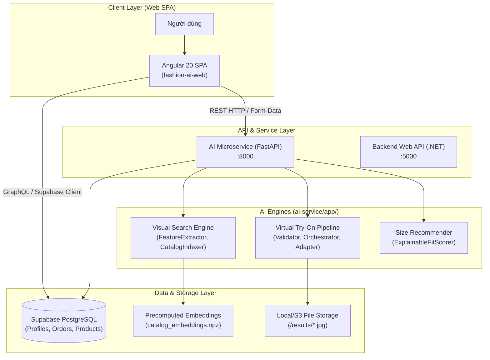
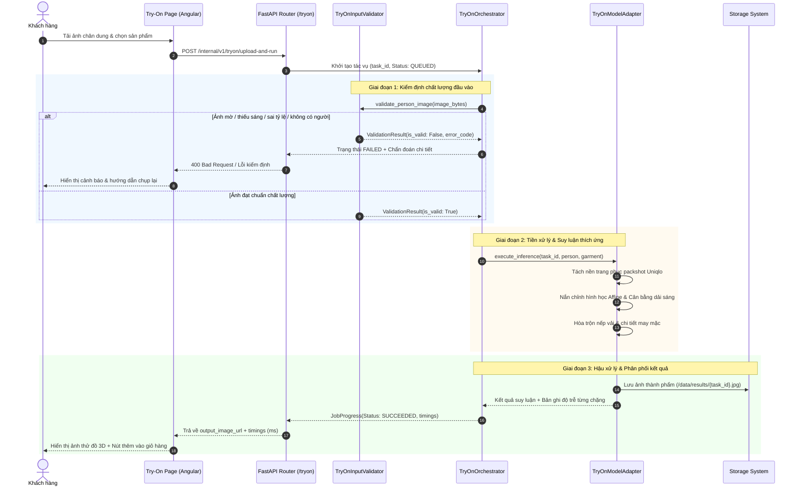
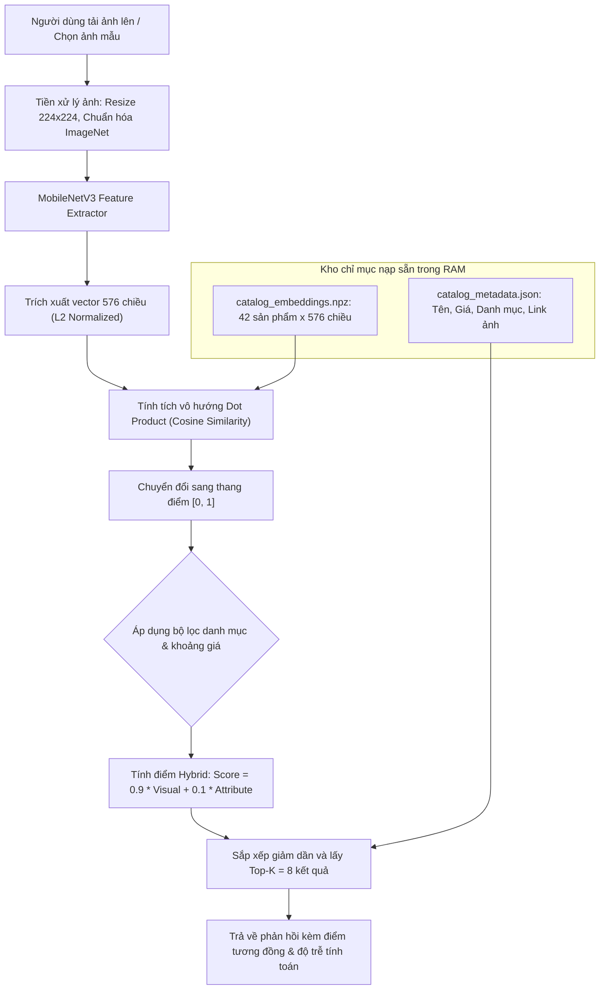
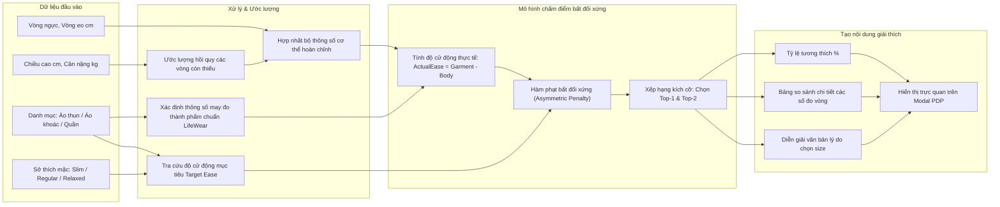
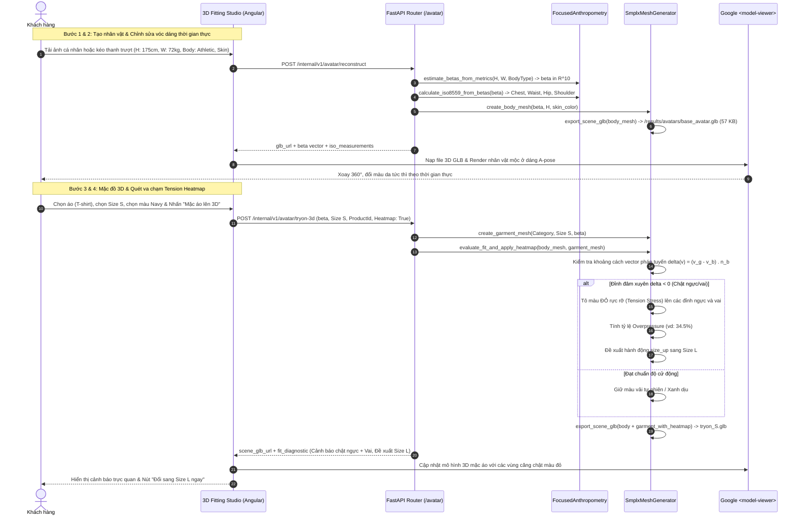

# KIẾN TRÚC ĐƯỜNG ỐNG HỆ THỐNG & TÍCH HỢP TOÀN DIỆN (SYSTEM PIPELINE)
## Dự án: Nền tảng Thương mại Điện tử Thời trang Tích hợp AI (SmartFit Fashion AI)
**Phiên bản**: 2.0  
**Ngày cập nhật**: 16/10/2026  

---

## 1. KIẾN TRÚC TỔNG THỂ HỆ THỐNG (SYSTEM ARCHITECTURE)

Hệ thống SmartFit được thiết kế theo mô hình Microservices phân tán, kết hợp giữa nền tảng Web SPA hiện đại, dịch vụ suy luận AI chuyên biệt và hệ quản trị cơ sở dữ liệu quan hệ PostgreSQL (Supabase):

---

## 2. ĐƯỜNG ỐNG THỬ ĐỒ ẢO CHI TIẾT (VIRTUAL TRY-ON PIPELINE)

Quy trình thử đồ ảo được thiết kế theo mô hình kiểm định trước - suy luận sau (Fail-Fast Architecture), đảm bảo không lãng phí tài nguyên tính toán đối với ảnh không đạt chuẩn:

---

## 3. ĐƯỜNG ỐNG TÌM KIẾM BẰNG HÌNH ẢNH (VISUAL SEARCH PIPELINE)

Hệ thống tìm kiếm thị giác vận hành theo nguyên lý so khớp vector embedding trong không gian đa chiều:

---

## 4. ĐƯỜNG ỐNG TƯ VẤN KÍCH CỠ GIẢI THÍCH ĐƯỢC (SIZE RECOMMENDER PIPELINE)

---

## 5. ĐƯỜNG ỐNG SÂN KHẤU 3D NHÂN TRẮC HỌC & ĐÁNH GIÁ ĐỘ VỪA VẶN MESH (3D FITTING PIPELINE)

Quy trình tạo nhân vật 3D tương tác và đánh giá độ vừa vặn vật lý chuẩn ISO 8559:

---

## 6. CƠ CHẾ ĐẢM BẢO AN TOÀN & BẢO VỆ DỮ LIỆU RIÊNG TƯ (SECURITY & PRIVACY)

1. **Bảo mật ảnh cá nhân người dùng**:
   - Ảnh chân dung người dùng tải lên phục vụ thử đồ ảo được xử lý trong bộ nhớ tạm thời hoặc lưu trữ tại vùng bộ nhớ đệm riêng biệt, không công khai cho người dùng khác xem.
2. **Xác thực và ủy quyền đa tầng**:
   - Mọi thao tác mua sắm, quản lý đơn hàng và số đo cơ thể cá nhân được bảo vệ qua Supabase Row Level Security (RLS). Người dùng chỉ có quyền đọc và cập nhật bản ghi có `user_id = auth.uid()`.
3. **Chống giả mạo giá tiền và kho hàng**:
   - Client không bao giờ được phép gửi giá tiền tùy ý lên server. Mọi giá sản phẩm được tính toán độc lập tại tầng cơ sở dữ liệu dựa trên bảng `products` và `product_variants`.
